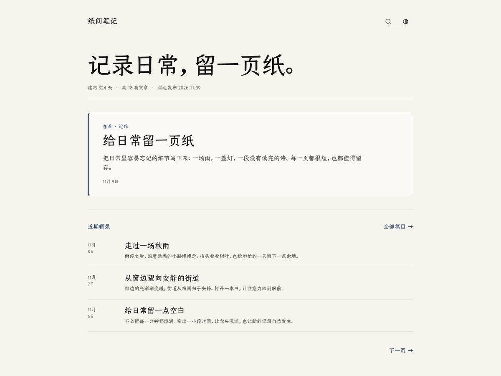

# Zen

专注排版、留白与阅读的 WordPress 博客主题，使用原生文章、页面、评论和友链数据，无需配套插件或构建步骤。

> **版本选择：** V2 版本经过了整体重构，与 V1 版本的 UI 设计完全不同，v1.6.5 是 V1 版本的最终版，具体差异请自行安装测试，按需选择。

- 仓耳今楷统一排版，适配手机与桌面，支持浅色、深色和跟随系统外观。
- 首页支持最新文章卡片、标准／紧凑列表；提供归档、标签、友链和留言模板。
- 文章支持标题目录、代码高亮与复制、图片灯箱、阅读进度和预计阅读时间。

## 安装与使用

**环境要求：WordPress 6.5+、PHP 8.0+。**

1. 从 [Releases](https://github.com/yahuisme/wordpress-zen/releases) 下载附件 **`zen.zip`**，不要选择 `Source code` 包（不含仓耳字库）。
2. 在后台「外观 → 主题 → 安装主题 → 上传主题」安装并启用 Zen。
3. 在「设置 → 常规」填写站点标题、副标题；Logo 在「外观 → 自定义 → 站点身份」设置。
4. 打开一级菜单「Zen 主题设置」，调整排版、首页列表、文章详情、页脚等选项并保存。

更新前备份数据库及主题文件，保留自己对主题文件的修改；上传新 `zen.zip`，选择替换当前主题即可，**同版本也可替换，无需重新导入内容**。安装或更新后，清理页面、CSS／JavaScript 合并及 CDN 缓存。

主题不会自动创建页面或导入演示内容。正文宽度默认 800px，可在 600–960px 内调整；文章目录取自 H2／H3 标题。高级代码仅供有 `unfiltered_html` 权限的账号填写可信代码。

## 页面与导航

在「页面 → 新建页面」选择对应模板并发布，标题和链接别名可自行设置：

| 用途 | 模板 | 建议别名 |
| --- | --- | --- |
| 归档 | `Archives Template` | `archives` |
| 标签 | `Tags Template` | `tags` |
| 友链 | `Links Template` | `links` |
| 留言 | `Notes Template` | `notes` |

- **归档与标签：** 自动汇总已发布文章及已使用标签。归档每批显示两个有文章的年份，月份默认展开；无脚本时显示完整目录。
- **友链：** 在后台「链接 → 添加」维护名称、网址、描述和图片；排序数字越小越靠前，`0` 排在最后。Logo 默认圆形黑白，悬停恢复彩色。
- **留言：** 编辑页面时在「讨论」中开启「允许评论」；审核和登录要求由「设置 → 讨论」控制。
- **页脚导航：** 默认显示已发布的模板页面；也可在「外观 → 菜单」创建菜单并指派到 `Footer Menu`。

## 字体与许可

Release 的 `zen.zip` 内置仓耳今楷，源码仓库不含字库。**字体版权与使用、再分发授权独立于主题 GPL**，请遵循包内字体说明。

主题代码采用 [GPL-3.0](LICENSE)，第三方资源许可见 [licenses](theme/zen/licenses/)。原作者 [qwer-xyz](https://github.com/qwer-xyz)，维护者 [RyanZ](https://github.com/yahuisme)。

## 开发

源码位于 [`theme/zen/`](theme/zen/)，测试说明见 [tests/README.md](tests/README.md)，历史变更见 [CHANGELOG.md](CHANGELOG.md)。手动工作流生成含字体安装包供人工发布；推送不会触发打包，也不会自动创建 tag 或 Release。
